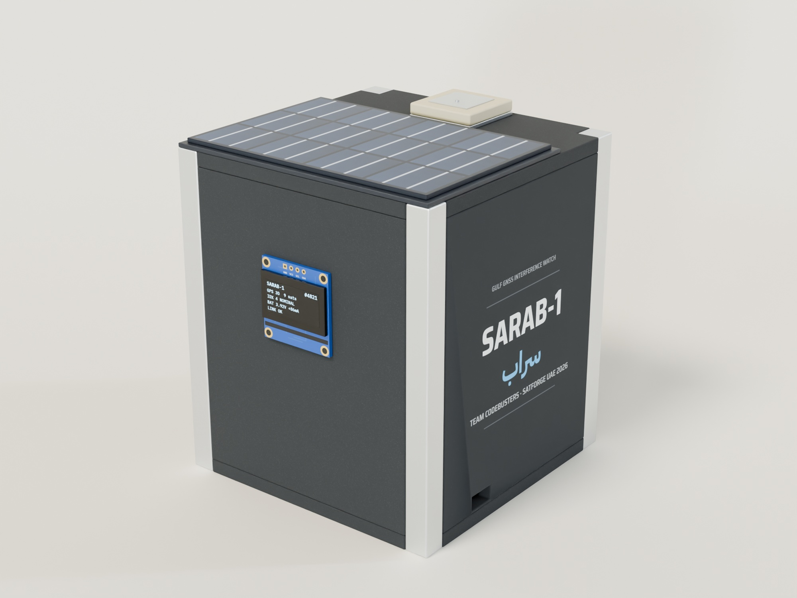

# SARAB-1 · Gulf GNSS Interference Watch



**SARAB-1** (سراب, "mirage") is a 1U CubeSat concept that listens to GPS signals over the Arabian Gulf and the Strait of Hormuz and flags where they are being jammed or faked. This repository holds the ground station dashboard, the 3D model of the tabletop prototype, the flight software and the build files.

Team CodeBusters · Al Ain University · SatForge UAE 2026

## What's here

| Path | What it is |
| --- | --- |
| `index.html` | Ground station dashboard: 3D Earth view, detection status, receiver health, signal strength per satellite, sky plot, spoofing checks, housekeeping, event log, signed telecommands, raw telemetry |
| `model.html` | Interactive 3D model of the prototype with exploded view, part callouts and the foam cut list |
| `src/` | Dashboard code (plain ES modules, no build step) |
| `firmware/sarab1/sarab1.ino` | ESP32 flight software |
| `hardware/build_model.py` | Single source of truth for the mechanical design; writes the part list (`src/parts-data.js`) and the Tinkercad STL files |
| `hardware/stl/` | STL files for Tinkercad, one per colour group, plus a merged assembly |
| `hardware/blender/` | Detailed Blender model built from the same part list: `build_sarab1.py` (model and website export), `render_sarab1.py` (studio renders), `textures.html` (board prints, labels and decal) |
| `assets/` | `sarab1.glb`, the detailed model the website loads, and `renders/` for the poster and report |

## Run it locally

```bash
python -m http.server 8080
```

Then open http://localhost:8080. The pages use ES modules, which need a server; opening the HTML file directly won't work.

## How the live link works

1. The prototype's ESP32 reads the u-blox receiver (signal strength per satellite, noise level, jamming indicator, gain), the INA219 on the battery line and the MPU6050 motion sensor.
2. It runs the detection on board and publishes one JSON packet per second over MQTT to a public relay (`broker.emqx.io`, with `broker.hivemq.com` as the fallback) on topic `sarab1/cb-7f3a91/tm`. Packets are retained, so a dashboard opened later still learns when the cube was last heard.
3. The dashboard listens on both relays at once over secure WebSockets, drops the duplicate copies and updates every panel as each packet lands.

When the cube is not transmitting, the dashboard shows a clearly labelled simulated pass in the same packet format. It switches to live data on its own as soon as packets arrive.

## Telemetry packet

```json
{
  "sat": "SARAB-1", "seq": 4821, "utc": "2026-10-23T08:20:31Z", "src": "HW",
  "gnss": { "fix": "3D", "lat": 24.2075, "lon": 55.7447, "nsat": 9, "agc_pct": 57.6, "noise": 101, "jam_ind": 9,
            "sats": [ { "prn": 2, "el": 62, "az": 40, "cn0": 44, "b": 44.1 } ] },
  "det":  { "index": 4, "state": "NOMINAL", "drop_db": 0.2, "cn0_mean": 40.3, "cn0_sd": 4.4, "cn0_el_r": 0.93, "pos_dev_km": 0.1,
            "base": { "noise": 100, "agc": 58.0, "jam": 8 }, "ack": "ok:recal:1761207600" },
  "eps":  { "vbat": 4.03, "ibat_ma": 86, "net_w": 0.35, "soc_pct": 90 },
  "adcs": { "roll_deg": 0.4, "pitch_deg": -1.1, "vib_g": 0.019 },
  "therm": { "board_c": 31.4 }
}
```

- `src` is `HW` from the cube, `TEST` from the test transmitter (`index.html?transmit`), and `SIM` for the built-in simulation.
- `gnss.agc_pct`, `noise` and `jam_ind` come from the receiver's hardware monitor; clone receivers that don't report it leave them out, and the dashboard says so.
- `det.base` is the clean baseline the cube learned. `det.cal` is `true` while it is still learning, `det.test` is `"replay"` during the spoofing replay test, and `det.ack` answers the last telecommand.
- `eps` is the battery line measured by the INA219: battery voltage, current (positive while charging, negative while draining) and net power. `soc_pct` is estimated from the voltage.
- The simulation adds `orbit` (its position along the pass) and `eps.solar_w` / `eps.load_w`; the cube doesn't send these.

## Telecommands

The dashboard's Telecommand panel sends two commands to the cube, on topic `sarab1/cb-7f3a91/cmd`:

| Command | What the cube does |
| --- | --- |
| `replay_spoof` | Replays a recorded spoofed signal for 20 s, to prove that spoofing detection works |
| `recal` | Forgets its clean baseline and learns it again, which takes about a minute |

Each command is `{"cmd": "recal", "ts": 1761207600, "sig": "…"}`, where `sig` is HMAC-SHA256 of `recal|1761207600` keyed with the team's command key (`COMMAND_PIN` in the firmware). The cube runs a command only if the signature matches, the time stamp is within 2 minutes of its own clock, and it is newer than the last command it ran, so a recorded command can't be replayed. It answers in `det.ack`: `ok:<cmd>:<ts>`, or `rejected:<cmd>:<ts>:<reason>` where the reason is `signature`, `stale`, `clock` or `unknown`.

The key stays in the browser tab it is typed into. Use a long random phrase: commands cross a public relay, so a short PIN could be guessed offline from a single captured command.

To try it without the cube, open `index.html?transmit` in a second tab and enter a key there. That tab then publishes TEST packets and checks commands exactly as the firmware does.

## Detection

The Interference Index (0–100) fuses four symptoms: how far signal strength has dropped below each satellite's clean baseline, how much the noise level has risen, the receiver's jamming indicator, and how far it has cut its gain. Above 30 the cube reports interference suspected; above 60, jamming. Spoofing is flagged when every satellite arrives at nearly the same strength regardless of its elevation and the position fix moves away from where it should be.

No jammer is ever used. Tests use signal blocking, local electronic noise and replayed spoofed tracks; jamming equipment is illegal in the UAE.

## 3D model and renders

The website's model (`assets/sarab1.glb`) and the renders in `assets/renders/` are built in Blender 5.2 from the same part list as the Tinkercad files, so the model, the cut list and the report always agree. After changing `hardware/build_model.py`:

```bash
python hardware/build_model.py
```

```bash
blender --background --factory-startup --python hardware/blender/build_sarab1.py -- --export
```

```bash
blender --background hardware/blender/sarab1.blend --python hardware/blender/render_sarab1.py -- hero exploded inside
```

The textures are drawn by `hardware/blender/textures.html`; `python hardware/blender/render_textures.py` saves them as PNGs with headless Chrome.

## Credits

Earth imagery: NASA Blue Marble and Black Marble, via the three-globe example set. 3D rendering: three.js; detailed model and renders: Blender. Studio lighting in the renders: the CC0 "studio" HDRI by Greg Zaal (Poly Haven) that ships with Blender. Fonts: IBM Plex and Saira Semi Condensed (SIL Open Font License). Coastlines are simplified and schematic.
